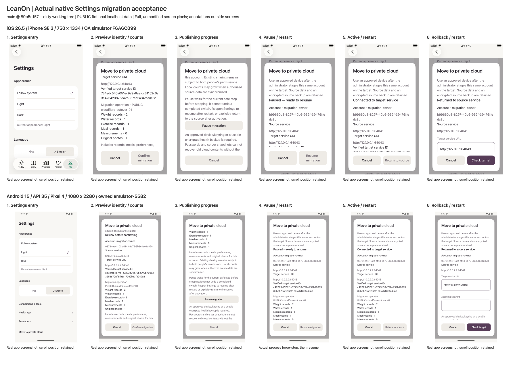

# LeanOn private Cloudflare relay: local implementation and verification

English · [简体中文](report.zh-CN.md)

**The local backend, both native photo protocols and actual Settings migration workflows are implemented and verified. Production deployment remains blocked.**
This is the Cloudflare implementation follow-up to the earlier UI/product work; it does not claim another visual review or substitute native test logs for UI screenshots.
The approved bottom bar and other page design were preserved.

## 2026-10-08: unified synthetic operator handoff

The remaining small local operator deliverable is now implemented: one CLI, an independent JSON parameter template, strict validation and isolated official Miniflare/workerd D1/R2 tests.
This reuses the existing `admin.ts`; that file, Settings, bridge actions and both native controllers were unchanged in this round.
The checkout remains `main` at `89b5e157844d62933a5ebfa773e7aa7b8d076cb9` with preexisting parallel changes; before/after fingerprints and scoped source are in `evidence/local-admin-2026-10-08/`.
Temporary official pnpm11.7.0 was used through command-scoped PATH, rebuilding the file-relay dependency and workspace without changing global tools.

### Delivered local commands and constraints

Run `node scripts/local-admin.mjs COMMAND --config FILE` from `server/companion-worker`, or use `pnpm --filter @zzzode/companion-worker admin:local`.
The commands are `init`, `backup`, `deletion-floor`, `restore`, `migration-plan` and `migration-stage`.
All default to dry-run; only explicit `--local-execute` opens the temporary local backend, and `migration-plan` always stays a preview.
The independent template is `server/companion-worker/templates/local-admin.example.json`; complete English/Chinese instructions are `local-admin.md` and `local-admin.zh-CN.md` in that package.

Dry-run validates configuration and bounded input encoding without opening D1/R2 or writing any file, including locks.
Restore preview explicitly returns `authentication: not-performed` and `databaseChecks: not-performed`; it does not pretend ciphertext authentication, target emptiness or an authoritative latest floor has been established.
Local execution invokes the existing authenticated restore and maintenance/checkpoint logic.
Migration staging checks the actual local D1 service identity against the configured public ID before importing identities/grants; it copies no old aggregate records.
The configured loopback origin is a planning label, not an HTTP destination the CLI contacts.

Unknown fields/arguments, remote origins (including HTTPS), credential-bearing URLs, traversal/absolute input paths, symlinks, overlapping state/input/output paths and invalid keys/envelopes are refused.
The workspace must be a fresh marked `leanon-admin-synthetic-*` directory directly under the system temporary directory or `/tmp`, with private permissions.
Key, backup and deletion floor require independent directories; keys must be 32 binary bytes with private permissions.
Initialization generates no operator key, account, admission token or production credential.
Exports atomically publish complete private files without replacing an existing output.
Output is public service IDs/counts/status or fixed error codes; raw exceptions, credentials, account names, encrypted manifests and ciphertext never enter stdout/stderr.
The local runtime uses loopback-only sockets, no telemetry or provider configuration, blocked outbound requests and explicit disposal.

### Verified results and cleanup

| Check | Actual result | Evidence under `evidence/local-admin-2026-10-08/` |
|---|---|---|
| Workspace | Strict typecheck/build pass; **502 tests pass**, 0 failures/skips | `workspace-typecheck.log`, `workspace-build.log`, `workspace-test.log` |
| Worker/operator tests | **53 pass**, including 35 new entry cases | `workspace-test.log`, `scoped-source/` |
| Compiled CLI | **45 checks pass** with two PUBLIC fictional legacy accounts; all six commands exercised | `compiled-cli-checks.json`, `compiled-cli-drill.log` |
| No-write previews | Complete persistent file contents/mtime fingerprints unchanged; no binding factory calls | Tests and compiled CLI receipts |
| Backup/restore | Exact independent R2 ciphertext restored, both accounts retained, sessions cleared | Compiled CLI receipt and tests |
| Latest deletion floor | Delete+ACK on actual Worker; restoring the earlier two-account snapshot retains only the other account and a zero-byte photo fence | Compiled CLI receipt and tests |
| Failure safety | Real D1 batch failure leaves HTTP maintenance 503; lock released on thrown failure, same authenticated import resumes 101 device rows; tampered/missing/stale inputs fail before target writes | Operator tests |
| Cleanup | Both compiled-drill workspaces and parameter directory removed, runtimes disposed; test-owned directories removed | `compiled-cli-checks.json`, `cleanup.json` |

A retained lock is refused; after a hard process kill, operators must inspect the owned synthetic checkpoint and verify the old process ended before manually removing that lock.
The lock-refusal test is separate from the injected D1-interruption test; this round does not claim an actual OS-kill operator drill.
Exports remain bounded/in-memory rather than a production streaming design: 64 MiB per backup, 24 MiB per floor, 16 MiB per legacy input and 64 snapshot objects.
Build logs contain preexisting Pages MaxListeners warnings; builds succeeded and unrelated UI code was not changed.
No simulator/emulator or native QA setting was changed this round; the prior isolated iOS QA App/Keychain was not erased by this operator work.
Only scoped build/test evidence remains; no real data, provider login, paid activation, remote resource creation, deployment, commit or push occurred.

### Remaining production boundary

The local management CLI/template/test gap is closed; a production remote runner is still unimplemented, rather than merely waiting to be executed.
It needs provider account/resource binding, approved CPU/billing choices, data-location and backup/floor/key-retention decisions, plus remote capacity/fault acceptance.
The total-device-loss reset/re-pairing policy or portable companion-key recovery choice remains unimplemented pending the user's decision.
No new recovery policy, large-collection protocol or remote execution was added.
Both this English report and the Chinese report are synchronized and replace their original native Library identities.

## Latest acceptance: actual Settings migration entry

This updates the existing Cloudflare report and separates prior helper/protocol drills from the actual app entry acceptance below.
The 22:03 UTC resume checkpoint had 367 dirty entries and 724 source files; the existing Settings entry, sheet, six bridge actions and both controllers were retained.
718 baseline source files stayed identical, six existing files changed and seven scoped source/test files were added; hashes, line anchors and build timing boundaries are in `evidence/migration-entry/`.
Only isolated fictional data and localhost were used: no remote Cloudflare resource creation, paid activation, real health access/upload, commit or push.

### Entry and native behavior

The capability-gated Settings entry opens the actual migration sheet.
The six actions are `companion.getMigrationState`, `previewMigration`, `startMigration`, `resumeMigration`, `pauseMigration` and `rollbackMigration`, with native events and status polling.
Preview shows source/target origins, authenticated service identity, the same account, operation ID and record/original-photo counts; confirmation binds the native preview identity and revisions.
Confirmation/resume require fresh account and backup passwords plus explicit consent; passwords stay out of projected state and a restart never resumes automatically.
The original collection stays active until target verification and activation succeed; the encrypted source backup/journal remain retained.
Rollback requires separate consent and keeps current local health data while restoring the source connection; it deletes neither source nor target resources.
The iOS initial phase-write error path now releases its lock and running flag; an injected encryption-write failure test confirmed another thread could still read the checkpoint.

### Actual native app acceptance

| Platform | Actual device and isolation | Verified workflow |
|---|---|---|
| iOS | SE3 / iOS26.5, simulator `F6A6C099-B04B-4DA2-A114-70A70E9DBB5B`,750×1334, isolated `.uiqa` app and files | Me→Settings; preview, consent-free tap guard, confirmation, publishing, safe pause, terminate/relaunch, fresh credentials/resume, active/relaunch, confirmed rollback/relaunch; two actual UI tests pass |
| Android | Newly created Pixel4 / Android15 API35 arm64 `emulator-5582`,1080×2280, isolated `.uiqa` app | Actual Settings entry and complete workflow, plus real `am force-stop` while publication waits on a requested pause; a new process recovers the encrypted checkpoint and resumes successfully |

Each platform used a separate fictional owner with 2 weights, 1 water record, 1 exercise, 1 legacy meal, 0 measurements, 1 public original-photo fixture and complete preferences.
The local operator fixture also staged a second fictional account; this UI acceptance covers one approved device per platform and does not claim concurrent two-person/multiple-device UI migration.
Complete canonical health backups match excluding only export time/local revisions; original photos match exact bytes.
Repeated active start/resume and rolled-back rollback are idempotent, and encrypted source journals remain retained.
Each old relay retained 2 accounts and 2 opaque legacy vaults without source account deletion; only counts, not verifiers or runtime keys, enter the evidence.

Workspace typecheck/build pass; Rstest has **467 passing tests**, including 3 added migration projection/resume/polling cases; final Worker/admin tests pass 18.
Android JVM reports 245 tests, 0 failures/errors and 1 existing opt-in environment skip; actual migration instrumentation passes separately.
Both embedded Lynx bundles have SHA-256 `991d46ce693e23794298f9658daa197f311e0bf389d79c5badb61c090fa75f92`.
iOS preview-to-active UI ran before the narrow exception-unlock fix; the final rebuild verified its injected failure recovery and active native preservation, and actual rollback/restart UI ran on the final signed binary. Lynx bytes stayed identical throughout.

28 actual screenshots (iOS12, Android16), accessibility trees and read-only native checkpoints are in `evidence/migration-entry/`.
Screens were not redrawn or cropped; the overview only scales and lays them out with external labels.
Some visible Android phase text is absent from the Lynx accessibility tree, so actual pixels are corroborated with read-only native checkpoints, without state injection.
iOS reports `Unavailable` for gated buttons and real taps are guarded, but that does not prove complete native disabled traits.
This UI run covers English/light appearance; Chinese, dark/large font, VoiceOver/TalkBack and physical devices remain unverified.

Native-state evidence redacts expired preview tokens; screen images and visible account/service/count fields are preserved.
The iOS Settings overview starts at the page top; its migration row was reached by actual scrolling/tapping before opening the sheet.

### Operator tooling boundary

`server/companion-worker/scripts/migration-plan.mjs` accepts explicit `--dry-run` only and emits validated counts, a source digest and plan steps; invalid service IDs and non-HTTPS remote origins fail closed.
Pure `planLegacyMigration` has no D1/R2/network binding and emits no verifiers, proofs or aggregate ciphertext; the CLI has no remote execution mode.
`local-migration-entry-fixture.mjs` runs the old file relay and official Miniflare/workerd D1/R2 on 127.0.0.1 only; a fault proxy delays completion to expose real publishing/pause states.
Production remote runners, provider/resource/secret setup, operational backup destinations and capacity acceptance remain outstanding.

## Scope and checkout

The parent thread authorized local Workers + D1 + private R2 implementation and synthetic verification for exactly the user and partner.
Deployment, paid-resource activation, production credentials, real health uploads, commits and pushes were excluded.
The checkout remains `main` at `89b5e157844d62933a5ebfa773e7aa7b8d076cb9`; origin is `https://github.com/Zzzode/LeanOn.git`.
The 17:31 UTC checkpoint already contained 358 dirty entries from previous/parallel work; this is not a clean HEAD-only build.
`scoped-change-audit.json` records source fingerprints, retained files and scope checks; generated Pods/build/dist/project files are excluded.
New implementation is isolated in `server/companion-worker`; existing native companion sources and the admission form were extended.
No Git history or remote was changed.

## Verified outcomes

| Check | Actual environment and outcome | Evidence |
|---|---|---|
| Workspace build | All 13 packages pass, including native Lynx and web bundles | `evidence/cloudflare-workspace-build.log` |
| Workspace types | Strict checks pass, including the pages TypeScript 6 exception | `evidence/cloudflare-workspace-typecheck.log` |
| TypeScript behavior | 464 tests pass, 0 failures, 0 skips; includes 32 old file-relay and 18 Worker tests | `evidence/cloudflare-workspace-test.log` |
| Worker/D1/R2 | Official Miniflare 5 / actual workerd, 18 tests pass | `evidence/cloudflare-test.log` |
| iOS companion regression | 22 tests pass, 0 failures/skips, actual iOS Simulator 26.5 / SE 3rd generation, disposable device `24F40EDA-5E58-4D10-9192-75E8DF36F7DF` | `evidence/cloudflare-ios-final.log` |
| Android companion JVM | 27 tests pass, 0 failures/skips, includes actual HTTP to local Worker | `evidence/cloudflare-android-final.log` and XML |
| Actual cross-platform partner flow | One iOS owner and one Android partner on the same local workerd: 12 staged runs / 15 checks pass | `cross-platform-checks.json`, `evidence/cross-platform/` |
| Native legacy cutover | iOS 1 additional test and Android 8 checks pass; real Keychain/Keystore, old-source preservation, interrupted upload retry, complete health recovery | `evidence/cloudflare-ios-migration.log`, `android-migration-checks.json` |
| Android actual native flow | 9 checks pass on task-created API 35 arm64 emulator `emulator-5580`, isolated `.uiqa` package; real Keystore, Bitmap validation and transaction journal | `android-native-checks.json` |

Native checks used PUBLIC fictional backup/photo fixtures and newly created synthetic accounts only.
They covered registration without automatic data attachment, separate AES-GCM R2 photos, lost upload response with identical durable ciphertext retry, pairing/grants, durable encouragement delivery ACK, explicitly approved second-device key recovery, photo-sharing revocation/cache clearing and account deletion preserving chosen local data.
Android additionally verified fixture files and fixture Keystore keys were removed.
iOS regression uses disposable directories and fixture keys; the additional migration drill uses the actual simulator Keychain under local ad-hoc signing. The existing personal iOS simulator was not used.
The two platforms match independent frozen Node cryptographic vectors; each actual native pairing test used clients of its own platform.
A subsequent actual iOS-to-Android and Android-to-iOS partner test passed through one local workerd; see the coverage section below.
No physical-device, production TLS, hardware permissions or remote region test is claimed.

## Actual cross-platform coverage and remaining acceptance

The follow-up used one official Miniflare/workerd instance with the same D1/private R2 bindings on host port 64045.
A disposable iOS SE 3 simulator (iOS 26.5, `E563015C-5EE9-4E73-8F65-89C8714BE540`) registered the owner; the disposable API35 arm64 Android emulator `emulator-5580` registered a different partner account.
iOS used `127.0.0.1:64045`, Android used the emulator's host-loopback mapping `10.0.2.2:64045`; both reached the same local Worker.
Actual platform Keychain/Keystore and native cryptography/persistence were used across separate staged app processes.
This supplements the earlier independent platform tests and frozen vectors; those earlier tests alone did not prove live interoperability.

| Direction | Actual verified behavior |
|---|---|
| iOS → Android | Partner pairing proof/confirmation, explicit grants, 81.0 kg weight, public fixture JPEG matching its exact bytes, encrypted encouragement |
| Android → iOS | Independent 78.9 kg weight, a different native-generated/sanitized JPEG matching its complete SHA-256 digest, encrypted encouragement |
| Both message directions | Recipient persistence followed by ACK changes the other platform's outgoing status to `delivered` |
| iOS withdrawal → Android | Shared weight/photo cache removed; authenticated old private object URL returns `404 object_unavailable` after ciphertext cleanup |
| Android withdrawal → iOS | Shared weight/photo cache removed; a still-valid session's old object URL returns `object_unavailable`, not photo bytes |
| Cleanup | Separate native fixture files and Keychain/Keystore keys removed; local runtime and disposable devices stopped/deleted |

The two JPEG digests differ: iOS `902b88fb192ea99ddf99e5f2bd279afc0203dbbbb8ac79b5ee6356677d3d53c1`, Android `8cb4d535227e357f46caf0b15e09626db2473a5c59c607948b52e52364a68548`.
All 12 staged native runs and 15 checks passed, including seven executions of the opt-in iOS cross-platform test method and five Android instrumentation stages.
The representative exchanged record category was exact weight; this is not a claim that every health category, large collection or physical-device scenario was exercised cross-platform.
Production HTTPS, real mobile networks, remote runtime limits/concurrency/large-photo behavior and physical-device acceptance remain unverified.
The supplemental changes are QA harnesses and coverage documentation.

### Current migration entry versus production operations

The backend staged import/completion protocol and native `CompanionCloudflareMigration.prepare/publish` helpers exist and passed synthetic cutover tests.
Their earlier callers were native QA tests; the latest acceptance now exercises the actual Settings entry, six bridge actions and both native controllers.
The local product entry supports preview, confirmation, phase progress, pause/resume and explicit rollback, with screenshots and preservation checks above.
A production remote administration/migration/backup runner and provider/resource/secret configuration also remain outstanding.
Remaining gates include operational runners, provider setup and production acceptance; they are not just a deployment switch.
No new total-device-loss recovery policy was implemented in this follow-up.

## Implementation and security behavior

D1 stores normalized accounts/devices/session hashes, exactly two admission slots, grants/groups/invitations, current encrypted records, replay/nonces/delivery receipts, private object references and deletion jobs.
A guarded compare-and-swap batch rolls back on revision conflict; every mutation reads the revision before its permission reads.
There is no whole-state health JSON row or filesystem-fsync hot path in the new Worker.
Sessions persist across workerd restart, bind device proof, expire after 30 minutes and revoke persistently on logout/deletion.
Registration requires an expiring, login-bound hashed admission ticket; consumption is atomic, replay is rejected, and deletion does not automatically reopen a slot.

New password hashes use scrypt `N=16384,r=8,p=5`, random16-byte salts and 64-byte output.
This combination is in the current [OWASP minimum configurations](https://cheatsheetseries.owasp.org/cheatsheets/Password_Storage_Cheat_Sheet.html).
Imported `p=1` verifiers upgrade only after a successful login; wrong-password attempts do not rewrite them.
Persistent global/login budgets and a one-minute distributed lease serialize memory-hard session authentication across isolates.
Expired budgets are pruned; a crashed lease recovers after expiry.

Photo bytes are encrypted independently by native clients with HKDF-derived per-object keys and routing-bound AES-GCM AAD.
D1 receives a small authenticated manifest binding every object digest/size; the Worker never holds an E2EE key or decrypted photo.
Private R2 access goes through authenticated, non-cacheable Worker routes.
A durable reservation precedes immutable conditional PUT; retries reuse the exact ciphertext packet stored in the encrypted native outbox.
Revocation replaces ciphertext with a strongly verified zero-byte fence, then marks its D1 row fenced and clears digest/size.
Fences deliberately remain and prevent a delayed conditional PUT from resurrecting bytes; they are not health ciphertext and must not be lifecycle-deleted.
Downloaded copies cannot be remotely erased; native refresh clears this application's revoked peer cache.

Deletion atomically revokes sessions/devices/membership and creates a proof-hash job before touching R2.
Receipt and ACK stay unavailable until actual ciphertext cleanup completes.
A local fault/restart test injected an R2 outage, then invoked the real workerd scheduled event through the official service binding and verified job completion before receipt.
The scheduled handler shares the same Worker; no additional production service or queue was introduced.

## Backup, restore and migration boundary

An independent 32-byte operator key encrypts/authenticates the D1 manifest and object inventory; R2 remains client-encrypted.
Restore requires an authoritative latest deletion floor independently retained from historical snapshots, authenticates all object bytes before writing, preserves revoked grants/fences and clears sessions.
The tested old-snapshot restore after completed deletion ACK did not revive the deleted account, object bytes or pending job.
Tampered/missing objects, a wrong key, a stale floor and a populated target were rejected.
An old snapshot plus an old floor cannot prove that a newer deletion never occurred; floor retention is an operator obligation.

Offline D1 import uses at most 32 data statements per transaction plus guards/checkpoint.
During incomplete import, HTTP and cron stay closed through a persisted maintenance gate.
An injected mid-import failure left the target unavailable; the exact same authenticated input resumed it without duplicate identities and restored 101 device rows.
The admin module runs locally under Node with official D1/R2 bindings; a production remote backup/export runner and destination are not implemented or configured.
Exports require quiesced clients/cron and currently materialize the bounded table/object inventory in the Node process; production streaming/capacity acceptance remains outstanding.

Legacy migration validates the actual file-relay format and retains eligible account/device IDs and password compatibility verifiers.
Default opaque aggregate import remains fail-closed before target writes.
An explicit staged migration imports only identity/grants, rotates every group epoch and records pending migration jobs; it copies no old aggregate ciphertext, delivery receipts, cursors or nonce ledger into the new realm.
Both native hosts now implement `prepare`/`publish`: sync and decrypt the legacy aggregate, make an existing password-encrypted portable health backup, derive fresh operation-bound group keys, persist a device-encrypted cutover journal, restore into a separate empty native collection and republish small authenticated manifests plus independent R2 photos.
Only successful native sync plus server object/reference checks marks the migration complete.
The old source collection and old relay remain intact for rollback; returning to the source after further target edits requires an explicit reconciliation decision.
An interrupted target uses the same journal and exact ciphertext packets, with phase/checkpoint checks preventing accidental source overwrite.

The actual iOS Keychain drill and Android Keystore drill each migrated two PUBLIC fictional legacy accounts and photos, injected loss of a successful photo-upload response, reopened the encrypted journal and completed a retry.
An explicitly approved fresh device then recovered the complete migrated health backup, compared against the source excluding export time and local revision counters.
Android passed eight migration checks, including fixture-file/key cleanup; iOS passed its additional migration test (23 companion tests total across the final regression and separate migration runs).
See `android-migration-checks.json` and `evidence/cloudflare-ios-migration.log`.
Those were the earlier helper-level drills; the new actual Settings entry acceptance is listed separately above. A remote admin runner remains outstanding and no real-account cutover is claimed.
Collections beyond the explicit manifest/record limits are refused rather than truncated.

Server snapshots contain no client E2EE keys.
An approved native device can recover the current cloud contents by explicit device invitation, as tested.
The existing PBKDF2/AES-GCM portable health backup can instead restore health records and photos **as of that backup**, using its backup password; the migration drill reuses that existing implementation.
It does not export companion group keys, and the device-bound cutover journal is not a portable key backup.
If all approved devices are lost, account passwords and server snapshots cannot decrypt the old cloud ciphertext.
A valid portable health backup still recovers its own snapshot; safely resuming cloud service then needs fresh keys and re-pairing under an approved account/device-reset procedure, which is not implemented here.
The smallest remaining recovery decision is whether snapshot recovery with new keys/pairing is sufficient, or whether preserving old cloud identity/history requires a separately reviewed portable companion-key recovery design.
Neither option promises recovery without keys or a usable encrypted health backup.

## Measured resource decision

The reproducible `scripts/local-profile.mjs` measured the **actual child workerd process**, not Node's parent CPU or request latency alone.
Twenty warm sequential successful logins consumed 1620 ms aggregate process CPU: **81 ms/request**.
Median wall time was 84.45 ms, p95 88.22 ms, and sampled process RSS peaked at **114.67 MiB**.
See `local-performance.json`; CPU includes local D1/R2 subworkers, and sampled process RSS is neither isolate heap nor a guaranteed maximum.
These local measurements do not predict remote quota or physical-device latency.

Cloudflare currently documents **10 ms CPU/request on Free** and **128 MB memory on both plans**. [Worker limits](https://developers.cloudflare.com/workers/platform/limits/)
We cannot approve Free-plan feasibility for this verifier and have not weakened it to fit the budget.
The smallest concrete billing choice is to authorize Workers Paid for remote acceptance; its current subscription starts at **US$5/month**, with separate usage/resource charges possible. [Official pricing](https://developers.cloudflare.com/workers/platform/pricing/)
Alternatively, choose a reviewed external identity flow while retaining private two-person admission and native E2EE; that alternative is not implemented.
Neither option was activated, no provider account was logged in, and no funds were spent.
Paid does not raise the memory limit; remote large-photo/concurrency and cron CPU tests are still required.

## Capacity and remaining gates

| Gate | Current truthful state | Required before production |
|---|---|---|
| CPU/billing | Safe verifier and local measurements complete | Authorize a CPU budget/identity choice, then remote acceptance |
| Large collections | Explicit bounds: 512 KiB control/response, 128 KiB small ciphertext, 4-item sync/ACK/reserve, 64-photo manifest, 20 MiB+28-byte photo | Chunked manifests/records and retry/capacity UX before importing larger existing collections |
| Legacy data | Both aggregate cutovers, new-device recovery and actual Settings pause/resume/rollback with source preservation passed | Remote operator runner/rehearsal and larger-collection design |
| Total device loss | Approved-device recovery and existing health-backup restoration tested; cloud keys are not portable | Choose snapshot/new-key reset policy or separately review portable companion-key recovery |
| Operations | Unified default-dry-run local CLI, independent template and authenticated snapshot/floor restore tested | Remote runner, provider binding, independent production floor/key storage, retention and object-memory/load acceptance |
| Platform acceptance | Independent native regressions, frozen vectors and same-workerd bidirectional partner data/photo/revocation tests passed | Production HTTPS, physical-device networks and remote capacity/fault acceptance |

Code/function line numbers and source hashes are listed in `code-evidence.md`/`code-evidence.json`.
The Library evidence ZIP includes the new backend, scoped changed native/page sources, RFC, checks and source audit; it excludes runtime stores, synthetic live bearer credentials, Pods, node_modules and unrelated parallel source changes.
This deliverable is a reviewable local implementation with explicit deployment gates, not a declaration that production adoption or real-account migration is complete.
